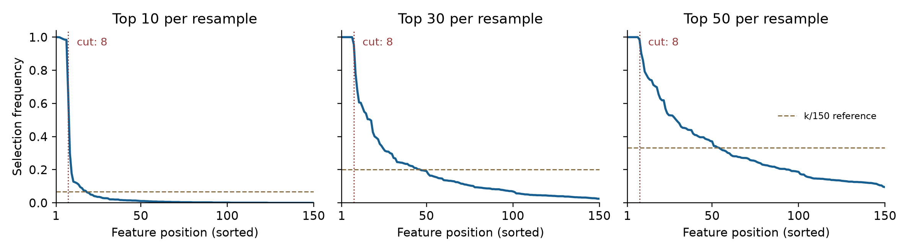

# Individual Extension 4 — Stability of the feature ranking

Cao Wei  |  DSAI4203  |  Revised 28 November 2026

## Question

How stable are absolute Pearson correlation rankings in a dataset with 250 rows and 150 features? Do stable subsets help prediction, and does bootstrap selection change which features are retained when their number is held constant?

## Protocol

Let k be the number of features retained per resample. For k = 10, 30 and 50, draw 1,000 bootstrap samples of 250 rows with replacement, recompute absolute Pearson correlations with the target, and record top-k inclusion frequencies. All settings share resamples (seed 20261125). The k/150 reference is not a significance threshold.

Sort frequencies decreasingly and retain the prefix ending at the largest adjacent drop. Tied drops use the smaller prefix; tied feature scores use original column order. If all drops are zero, retain all features. This prespecified heuristic does not prove a distinct feature group. Full-data curves are descriptive only.

Prediction uses five repeats of stratified five-fold CV (seed 420304). Within each 200-row training fold, repeat the 1,000-sample bootstrap, select features, and fit scaling and the classifier; the 50 validation rows do not enter these steps. All methods share splits. Report mean AUC, sample SD and range across the five repeat-level mean fold AUCs. Repeats reuse data and are not independent tests.

Models are fixed: L2 logistic regression (LR; C = 1, lbfgs, max_iter = 10000, seed 42) and supplementary QDA (reg_param = 10-6, tol = 10-10). All-feature QDA failed under the original installed configuration before predictive scores were obtained. The documented 25 November amendment added LR for the complete all-feature comparison; all-feature QDA remains unavailable.

On 28 November, a post-hoc audit compared archived selected sets with ordinary Pearson sets of the same size and counted inclusion across training folds. It used training rows only for each Pearson ranking and performed no new model fits or AUC estimation.

## Results

Figure 1. Full-data frequencies, sorted separately for each k. All largest drops occur after eight features. Boundary pairs are 0.661/0.299, 0.955/0.778 and 0.985/0.903; gaps are 0.362, 0.177 and 0.082. Separation weakens as k increases.

The full-data set is {17, 46, 49, 77, 80, 98, 100, 112}. For k = 10, seven features {17, 46, 77, 80, 98, 100, 112} appear in all 25 training-fold sets; feature 49 appears in only 6. Selected sizes are 7 in 19 folds, 8 in five and 9 in one. Thus, the full-data eight-feature boundary contains a more consistently selected seven-feature core. These are dependent fold counts, not inclusion probabilities for new datasets.

## Results continued

| Classifier and features | Count | Mean AUC | SD | Repeat range |
| --- | --- | --- | --- | --- |
| LR / All features | 150 | 0.7556 | 0.0190 | 0.7333-0.7770 |
| LR / Pearson top 30 | 30 | 0.8181 | 0.0196 | 0.7898-0.8405 |
| LR / Stable k = 10 | 7-9 | 0.8589 | 0.0047 | 0.8525-0.8656 |
| LR / Stable k = 30 | 7-13 | 0.8496 | 0.0148 | 0.8254-0.8617 |
| LR / Stable k = 50 | 8-15 | 0.8416 | 0.0120 | 0.8225-0.8547 |
| QDA / Pearson top 30 | 30 | 0.9944 | 0.0045 | 0.9871-0.9984 |
| QDA / Stable k = 10 | 7-9 | 0.9755 | 0.0035 | 0.9722-0.9803 |
| QDA / Stable k = 30 | 7-13 | 0.9853 | 0.0049 | 0.9768-0.9887 |
| QDA / Stable k = 50 | 8-15 | 0.9892 | 0.0039 | 0.9855-0.9958 |
| QDA / All features | 150 | Unavailable | - | Fit failure |

Table 1. Original 25 November fixed-model CV results, unchanged by this revision. Counts vary by training fold. SD describes five repeat-level means; it is not a standard error or confidence interval.

For LR, all features score 0.7556, ordinary Pearson top 30 scores 0.8181, and stable subsets score 0.8416-0.8589. Stable k = 10 gains 0.1033 over all-feature LR on average (paired repeat range 0.0822-0.1240; all five gains positive). For QDA, ordinary top 30 scores 0.9944, above every stable-subset mean (0.9755-0.9892). These are fixed-model CV estimates, not nested-search or Kaggle scores.

Same-size feature identity. Let m be the number selected by bootstrap in a given training fold. Recompute ordinary absolute Pearson rankings on that fold and take the first m features. The resulting set equals the archived stable set in 25/25 folds for each k, or 75/75 checks overall. Equality refers to membership, not necessarily feature order. This establishes that the observed method retained no different features from Pearson at the same count; it does not measure a new AUC gain.

Because m still comes from bootstrap, this audit is conditional on its chosen count. It does not test whether bootstrap chooses the count better than a method that chooses it without bootstrap. The observed LR gain therefore cannot be attributed to superior feature identities at fixed size. A future comparison would select the Pearson count inside the outer training fold, with any tuning confined to inner validation.

Boundary sensitivity across settings. Feature 49 is retained in 6/25 folds at k = 10, 20/25 at k = 30 and 25/25 at k = 50. The other seven full-data features appear in every fold under all three settings. This shows how the boundary feature depends on the selection setting; the full-data eight-feature set was never imposed on validation folds.

## Conclusion

The full-data plots identify an eight-feature boundary, while fold-local selection reveals seven consistently retained features and a setting-sensitive eighth. The stable subsets improve this fixed LR configuration relative to all features, but underperform top-30 QDA. Bootstrap supplies stability descriptions and a rule for choosing how many features to retain; the audit shows identical feature membership to ordinary Pearson when that number is held constant.

Limits remain: the cutoff is heuristic, training folds overlap, the audit is post hoc, and the count-selection rule has no independent comparator. Adaptive reuse of 250 rows limits generalization. No untouched test set or new leaderboard evaluation was used. Less-stable features may help QDA through covariance information, but that mechanism was not tested.

Reproducibility: original feature_stability_2026-11-25_v2.py and archived CSVs; new selection_audit_2026-11-28.py and audit outputs. Original environment: Python 3.12, scikit-learn 1.9.1. Shared project with Ron; this individual extension is for Cao Wei. OpenAI Codex assisted with design, implementation, execution, analysis and drafting.
